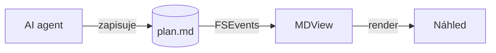

# Výsledek běhu agenta

> [!TIP]
> MDView obnoví náhled pokaždé, když agent soubor uloží – bez dialogů a se zachovanou pozicí.

## Změny

| Soubor | Změna | Řádky |
|---|---|--:|
| `Sources/Watcher.swift` | kqueue + FSEvents | +128 −14 |
| `Tests/WatcherTests.swift` | nové testy | +96 |

- [x] Implementace
- [x] Testy
- [ ] Code review :eyes:

## Tok dat



Latence náhledu $t < 200\,\text{ms}$, složitost $O(n \log n)$.

```swift
let watcher = FileWatcher(url: url) { event in
    render(event)
}
```
