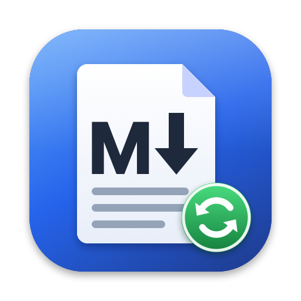
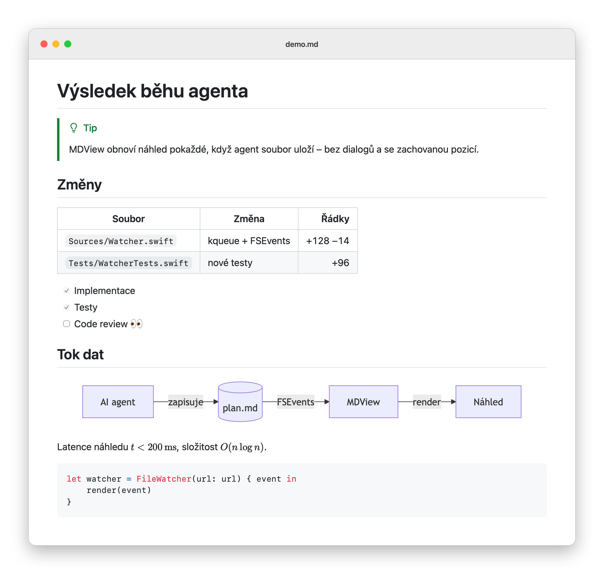

<p align="center">
  
</p>

<h1 align="center">MDView</h1>

<p align="center">
  Nativní Markdown viewer pro macOS (Apple Silicon), na sledování <code>.md</code> souborů, které zapisuje AI agent nebo editor.
</p>

<p align="center">
  <picture>
    <source media="(prefers-color-scheme: dark)" srcset="docs/images/preview-dark.png">
    
  </picture>
</p>

## Funkce

- **Spolehlivý auto-reload.** Přežije atomic save, streamování do otevřeného souboru, zkrácení a nový zápis, smazání a znovuvytvoření, přejmenování i přesun pryč a zpět. Náhled se obnoví potichu, bez dialogů, a zachová pozici čtení. Volitelně sleduje konec souboru, do kterého agent připisuje. Finální obsah ukáže zhruba 100–200 ms po posledním zápisu.
- **Rendering jako na GitHubu.** Parser cmark-gfm (stejný jako GitHub) a k němu GitHub alerts, Mermaid, matika (KaTeX, `$…$`, `$$…$$`, ```` ```math ````), footnotes, task listy, emoji zkratky, front matter a `<picture>` pro světlý a tmavý režim. Shodu ověřuje 45 golden testů proti GitHub API.
- **Bezpečnost.** JavaScript z dokumentu nikdy neběží: content JS je vypnutý a skripty aplikace mají vlastní izolovaný svět. Odkazy nic nespouštějí: `.md` se otevře v MDView, web v prohlížeči, ostatní soubory se jen ukážou ve Finderu.
- **Offline.** Všechny knihovny jsou přibalené, nic se nestahuje z CDN.
- **Nativní AppKit aplikace.** Taby, Otevřít nedávné, obnova oken včetně pozice, světlý i tmavý režim a zoom.
- **CLI `mdv`** pro otevírání souborů z terminálu.

## Instalace

Požadavky: macOS 15+, Apple Silicon, Xcode 26+, [XcodeGen](https://github.com/yonaskolb/XcodeGen).

```bash
brew install xcodegen
make install
```

`make install` sestaví Release a zkopíruje `MDView.app` do `/Applications`. Příkaz `mdv` nalinkuje do `/opt/homebrew/bin`.

Podpis je ve výchozím stavu ad-hoc. Pro stabilní identitu zkopíruj `Config/Local.xcconfig.example` do `Config/Local.xcconfig` a doplň Team ID. macOS si pak udělená oprávnění, třeba k `~/Documents`, pamatuje i po dalších buildech.

## Použití

```bash
mdv README.md
mdv -g plan.md
claude -p "Navrhni architekturu" | mdv -
```

`mdv -g` otevře soubor na pozadí, takže terminál neztratí fokus. `mdv -` vezme Markdown ze standardního vstupu.

| Zkratka | Akce |
|---|---|
| ⌘R | Znovu načíst |
| ⌘+ / ⌘− / ⌘0 | Zoom |
| ⌥⌘R | Zobrazit ve Finderu |
| ⌥⇧⌘C | Kopírovat cestu |
| Zobrazení → Sledovat konec souboru | Při připisování drží náhled na konci |

## Vývoj

```bash
make test                # renderer, golden testy proti GitHubu, watcher (swift test)
make build               # XcodeGen + Debug build
scripts/ci-integration.sh  # integrační testy v aplikaci (náhled, bezpečnost, zátěž auto-reloadu)
scripts/gh-golden.sh     # obnoví referenční výstupy GitHubu pro golden testy
scripts/readme-images.sh # ikona a snímky do README
make vendor              # aktualizace přibalených knihoven (web-vendor/package.json)
```

- Architektura a rozhodnutí: [docs/PLAN.md](docs/PLAN.md) a [docs/DECISIONS.md](docs/DECISIONS.md).
- Licence knihoven třetích stran: [docs/THIRD_PARTY_LICENSES.md](docs/THIRD_PARTY_LICENSES.md).
