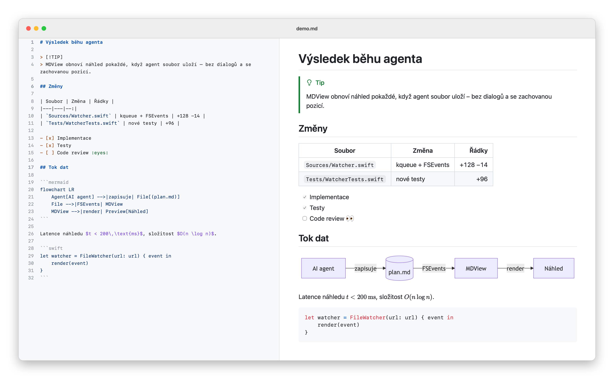

<p align="center">
  
</p>

<h1 align="center">MDView</h1>

<p align="center">
  Nativní Markdown viewer pro macOS (Apple Silicon), na sledování <code>.md</code> souborů, které zapisuje AI agent nebo editor. S jednoduchým režimem úprav.
</p>

<p align="center">
  <picture>
    <source media="(prefers-color-scheme: dark)" srcset=".github/images/preview-dark.png">
    
  </picture>
</p>

## Funkce

- **Spolehlivý auto-reload.** Přežije atomic save, streamování do otevřeného souboru, zkrácení a nový zápis, smazání a znovuvytvoření, přejmenování i přesun pryč a zpět. Náhled se obnoví potichu, bez dialogů, a zachová pozici čtení. Volitelně sleduje konec souboru, do kterého agent připisuje. Finální obsah ukáže zhruba 100–200 ms po posledním zápisu.
- **Rendering jako na GitHubu.** Parser cmark-gfm (stejný jako GitHub) a k němu GitHub alerts, Mermaid, matika (KaTeX, `$…$`, `$$…$$`, ```` ```math ````), footnotes, task listy, emoji zkratky, front matter a `<picture>` pro světlý a tmavý režim. Shodu ověřuje 45 golden testů proti GitHub API.
- **Bezpečnost.** JavaScript z dokumentu nikdy neběží: content JS je vypnutý a skripty aplikace mají vlastní izolovaný svět. Odkazy nic nespouštějí: `.md` se otevře v MDView, web v prohlížeči, ostatní soubory se jen ukážou ve Finderu.
- **Offline.** Všechny knihovny jsou přibalené, nic se nestahuje z CDN.
- **Pracovní složka (`mdv .`).** Strom všech `.md` souborů složky (bez `.git`, `node_modules`, buildů) se sekcí „Naposledy změněné“. Režim **Sledovat** přepne náhled na soubor, který agent právě zapsal nebo vytvořil.
- **Zvýraznění změn.** Bloky změněné při aktualizaci souboru krátce bliknou. ⌘J skočí na poslední změnu.
- **Zdrojový panel.** Zvýrazněný Markdown s čísly řádků vedle náhledu, se synchronizovaným scrollem oběma směry. Skok na nadpis zarovná oba panely na stejný řádek.
- **Režim úprav.** Tlačítko s tužkou v liště (⌥⌘E) nahradí zdrojový panel jednoduchým editorem. Náhled se překresluje při psaní a změny se samy uloží sekundu po posledním psaní (nebo hned přes ⌘S). Když agent soubor změní a ty nemáš nic neuloženého, editor jeho verzi potichu načte. Když máš rozepsané úpravy, objeví se banner: načíst verzi z disku, ponechat moje úpravy, nebo obě verze porovnat. Editor vzniká až při zapnutí, start aplikace nezdržuje.
- **Osnova, hledání a export.** Osnova dokumentu v postranním panelu zvýrazňuje aktuální sekci. Hledání ukazuje počet výsledků a volitelně ignoruje diakritiku. Export do samostatného HTML (bez skriptů, vše vložené) a do PDF, tisk vždy ve světlém tématu se stránkováním, které nerozdělí bloky.
- **Nativní AppKit aplikace.** Taby, Otevřít nedávné, obnova oken včetně pozice, světlý i tmavý režim s přepínačem v liště, lupa pro každý dokument zvlášť a nastavení. Nové okno se otevře tam, kde bylo naposledy zavřené.
- **Quick Look.** Mezerník ve Finderu ukáže náhled se stejným vykreslením jako aplikace. Běží v sandboxu, bez sítě a bez Mermaidu (diagram zůstane jako kód). 100KB dokument zobrazí zhruba za 0,35 s.
- **CLI `mdv`** pro otevírání souborů z terminálu.

<p align="center">
  <picture>
    <source media="(prefers-color-scheme: dark)" srcset=".github/images/source-dark.png">
    
  </picture>
</p>

## Instalace

### Stažení

Požadavky: macOS 15+, Apple Silicon.

Stáhni **[MDView.dmg](https://github.com/elvisek2020/app-markdown-viewer/releases/latest/download/MDView.dmg)** (poslední vydání, starší jsou v [Releases](https://github.com/elvisek2020/app-markdown-viewer/releases)), otevři ho a přetáhni MDView do složky Aplikace.

Aplikace je podepsaná, ale není notarizovaná. Při prvním spuštění macOS ohlásí, že ji nemůže ověřit. Otevři Nastavení systému → Soukromí a zabezpečení a klikni na Přesto otevřít. Totéž zařídí v Terminálu `xattr -dr com.apple.quarantine /Applications/MDView.app`.

- Příkaz `mdv`: `ln -sf /Applications/MDView.app/Contents/Resources/bin/mdv /opt/homebrew/bin/mdv`.
- Quick Look se zaregistruje při prvním spuštění aplikace. Když mezerník ve Finderu náhled MDView neukáže, zapni ho v Nastavení systému → Obecné → Položky při přihlášení a rozšíření → Quick Look.

### Z Terminálu

```bash
curl -fsSL https://raw.githubusercontent.com/elvisek2020/app-markdown-viewer/main/install.sh | bash
```

Skript stáhne poslední vydání a nainstaluje `MDView.app` do `/Applications`. Příkaz `mdv` nalinkuje do `/opt/homebrew/bin` (nebo `/usr/local/bin`) a zaregistruje Quick Look. Ověření v Nastavení systému odpadá, protože curl soubor neoznačí jako stažený z internetu. Stejným příkazem se aplikace aktualizuje. Konkrétní verzi nainstaluješ přes `MDV_VERSION=20261010.1754`.

Odinstalace: `rm -rf /Applications/MDView.app "$(which mdv)"`.

### Ze zdrojů

Požadavky: macOS 15+, Apple Silicon, Xcode 26+, [XcodeGen](https://github.com/yonaskolb/XcodeGen).

```bash
brew install xcodegen
make install
```

`make install` sestaví Release a zkopíruje `MDView.app` do `/Applications`. Příkaz `mdv` nalinkuje do `/opt/homebrew/bin`.

`make install` zároveň zaregistruje a povolí Quick Look rozšíření. Ověříš to v Nastavení systému → Obecné → Položky při přihlášení a rozšíření → Quick Look, nebo přes `make ql-status`. Když náhled souboru ve složce Dokumenty načítá obrázky vedle něj, macOS se jednou zeptá na přístup MDView ke složce Dokumenty.

Podpis je ve výchozím stavu ad-hoc. Pro stabilní identitu zkopíruj `Config/Local.xcconfig.example` do `Config/Local.xcconfig` a doplň Team ID. macOS si pak udělená oprávnění, třeba k `~/Documents`, pamatuje i po dalších buildech.

## Použití

```bash
mdv README.md
mdv .
mdv -g plan.md
claude -p "Navrhni architekturu" | mdv -
```

- `mdv .` otevře složku jako pracovní prostor.
- Neexistující soubor (`mdv plan.md`, který agent teprve vytvoří) `mdv` počká, až vznikne.
- `mdv -g` otevře soubor na pozadí, takže terminál neztratí fokus.
- `mdv -` vezme Markdown ze standardního vstupu.
- `mdv --version` vypíše verzi nainstalované aplikace.

Verze má formát RRRRMMDD.HHMM podle času buildu (například `20261010.1712`). Uvidíš ji v okně O aplikaci, v Nastavení a přes `mdv --version`.

| Zkratka | Akce |
|---|---|
| ⌥⌘E | Režim úprav |
| ⌘S | Uložit hned (v režimu úprav, jinak se ukládá samo) |
| ⌥⌘U | Zdrojový panel |
| ⌃⌘S | Osnova |
| ⌘F, ⌘G / ⇧⌘G | Hledat, další a předchozí výsledek |
| ⇧⌘L | Sledovat změny ve složce (pracovní složka) |
| ⌘J | Přejít na poslední změnu |
| ⌘R | Znovu načíst |
| ⌘+ / ⌘− / ⌘0 | Zoom |
| ⇧⌘E / ⌥⇧⌘E | Export do HTML / PDF |
| ⌘P | Tisk |
| ⌥⌘R | Zobrazit ve Finderu |
| ⌥⇧⌘C | Kopírovat cestu |
| ⌘, | Nastavení: vzhled, front matter, matika, emoji, obrázky z internetu, hledání bez diakritiky |
| Zobrazení → Sledovat konec souboru | Při připisování drží náhled na konci |

## Vývoj

```bash
make test                # renderer, golden testy proti GitHubu, watcher (swift test)
make build               # XcodeGen + Debug build
scripts/ci-integration.sh  # integrační testy v aplikaci (náhled, bezpečnost, hledání, export, synchronizace,
                           # zvýraznění změn, pracovní složka, režim úprav, zátěž auto-reloadu)
scripts/quicklook-check.sh # Quick Look nainstalované aplikace (registrace, vykreslení, rychlost, bez sítě)
scripts/gh-golden.sh     # obnoví referenční výstupy GitHubu pro golden testy
scripts/readme-images.sh # ikona a snímky do README
make vendor              # aktualizace přibalených knihoven (web-vendor/package.json)
make package             # podepsaný Release build jako MDView.dmg a MDView.zip (install.sh)
make publish             # vydání na GitHub Releases (tag v<verze>, assety MDView.dmg a MDView.zip)
```

Licence knihoven třetích stran: [THIRD_PARTY_LICENSES.md](THIRD_PARTY_LICENSES.md).
