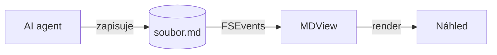

# MDView – ukázka všech prvků

Tento soubor slouží k vizuální kontrole renderingu. Porovnej ho s náhledem na GitHubu.

## Formátování

**Tučně**, *kurzíva*, ~~přeškrtnuté~~, `inline kód`, odkaz na [GitHub](https://github.com) a autolink https://example.com.
Česká diakritika: Příliš žluťoučký kůň úpěl ďábelské ódy.

## Tabulka

| Funkce | Stav | Poznámka |
|:---|:---:|---:|
| Auto-reload | ✅ | FSEvents |
| GFM | ✅ | cmark-gfm |
| Matika | ✅ | KaTeX |

## Task list

- [x] Kostra repa
- [x] Renderer
- [ ] Aplikace

## Poznámky pod čarou

Tvrzení s poznámkou[^zdroj] a další[^2].

[^zdroj]: Poznámka pod čarou s **formátováním**.
[^2]: Druhá poznámka.

## Alerts

> [!NOTE]
> Užitečná informace.

> [!TIP]
> Tip pro lepší práci.

> [!IMPORTANT]
> Klíčová informace.

> [!WARNING]
> Pozor na tohle.

> [!CAUTION]
> Riziko negativních následků.

## Mermaid



## Matika

Inline $E = mc^2$ i $`\sqrt{2}`$, cena $5 a $10 matika není.

$$
\int_0^\infty e^{-x^2}\,dx = \frac{\sqrt{\pi}}{2}
$$

```math
\sum_{n=1}^{\infty} \frac{1}{n^2} = \frac{\pi^2}{6}
```

## Kód

```swift
import Foundation

struct Greeter {
    let name: String

    func greet() -> String {
        "Ahoj, \(name)!"
    }
}

print(Greeter(name: "MDView").greet())
```

```bash
mdv Samples/showcase.md
scripts/agent-sim.sh /tmp/agent.md all
```

## Obrázek


## Citace

> Obyčejná citace bez alertu.
>
> Druhý odstavec citace.

---

Konec dokumentu.
